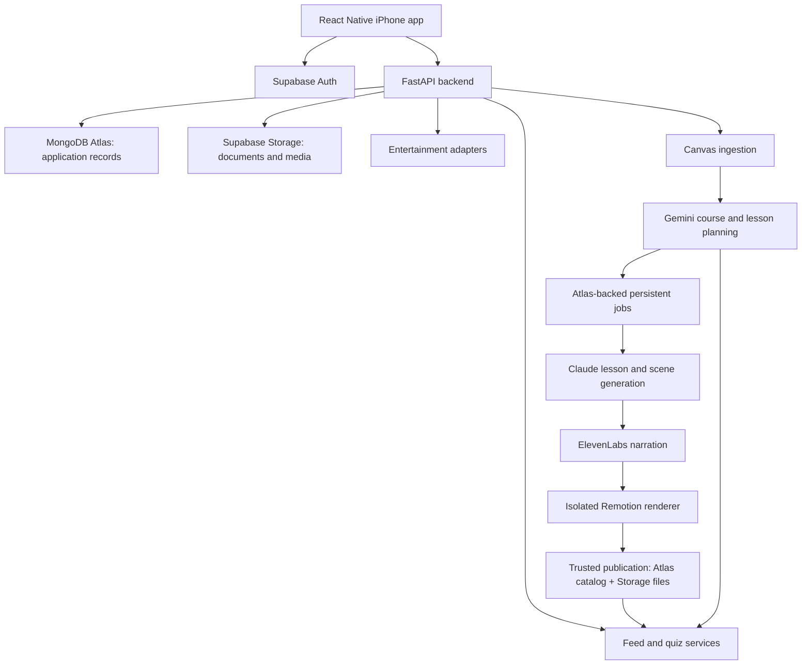

# Project specification and proposed architecture

Status: initial implementation proposal, November 13, 2026.
Working title: Study in your feed. Product name is undecided.

## 1. Product intent

Students already spend time swiping through short-form videos on their phones.
This app preserves that entertainment experience and gradually mixes in lessons
from the courses they are taking. It connects to Canvas, understands the course
calendar, prepares a diverse lesson library, and uses small quizzes to decide
what needs another explanation.

The core loop is:

1. Sign up and start watching entertainment immediately.
2. Connect Canvas or upload course materials.
3. Review the extracted course profile while lessons prepare in the background.
4. Encounter study videos in the entertainment feed.
5. Submit occasional quiz answers to resume scrolling.
6. Receive different explanations of weak topics, balanced across all courses.

The product must work on a real iPhone. Desktop browsing is not the intended
experience. For the demo, the entertainment feed may be nonpersonalized.

## 2. Confirmed requirements versus implementation defaults

| Confirmed by Agastya | Meaning |
|---|---|
| iPhone + React Native UI | Phone-first application, not a desktop extension |
| All Canvas courses | Import all accessible current enrolled courses; no single-course architecture |
| Quiz submission unlocks | Correctness influences recommendations, not permission to continue |
| Progressive study density | Begin entertainment-heavy; increase learning share during a session |
| Pre-generated videos | Generate during preprocessing; do not render on the swipe path |
| Shared common-topic videos | Reuse suitable lessons across users, e.g. linked-list reversal |
| 30–60 seconds | Each video teaches a small objective |
| 3–5 formats | Two specified; remaining formats proposed below |
| Gemini creates a video plan | Include core concepts and relevant algorithm/problem patterns |
| Cross-course diversity | Do not saturate a feed or generation batch with one unit |
| A few demos, no strict cost cap | Prioritize working quality, while retaining usage visibility |

Adopted database decision: MongoDB Atlas stores application records; Supabase
provides Auth and object storage. This replaces the initial Postgres application
database proposal. See the [accepted decision](decisions/001-proposed-atlas-application-data.md).

Remaining proposed defaults, not new user requirements: Expo, FastAPI, Remotion,
bounded database workers, ratio thresholds, numerical ranking weights, quiz
frequency, and initial generation batch sizes. Tune these without changing
confirmed product behavior.

## 3. Scope and staged delivery

### First usable product

Adi builds account signup/login, session persistence, a polished full-screen
vertical feed, and actual entertainment playback on an iPhone. Canvas is absent
from required onboarding. A mock catalog may unblock UI development, but the
milestone must distinguish mock playback from successful provider retrieval.

### Integrated demo

Connect a real test Canvas account, enumerate all current courses, ingest available
syllabi/slides/schedules, and show per-course readiness. Demonstrate multiple
courses even if a few lack accessible slides. Prepare at least two instructional
formats, mix study into entertainment, answer a quiz incorrectly, and later show
a different explanation of the same objective.

### Deferred

Production-scale scraping, exact replication of a personal FYP, native TikTok UI
injection, Screen Time gating, creator/social-sharing UI, a trained recommender,
and comprehensive automated pedagogical verification are not demo requirements.
Research-backed personalization is a planned post-demo direction (section 11),
with data collection and synthetic evaluation as preparatory work.
Shared lesson reuse is in scope even without a public share button.

## 4. Proposed system boundaries

This is a modular monolith plus background workers, not a fleet of independent
microservices. Python domains share the API runtime and database; Node owns
rendering. All long-running ingestion, model calls, and rendering run off the
HTTP request path. MongoDB Atlas is the application database; Supabase provides
app identity and object storage. Atlas holds source metadata, versioned course
profiles/plans, video metadata, jobs, quizzes and feed state. Original source files
and generated media bytes belong in Storage. No hosted resources have been
provisioned by this scaffold.

| Component | Responsibility | Explicit boundary |
|---|---|---|
| Mobile shell | Login, navigation, player lifecycle, feed gestures | No provider secrets or ranking logic |
| Auth adapter | Verify app identity; expose current user | App login is separate from Canvas connection |
| Entertainment | Fetch, normalize, validate and cache clip metadata | Does not decide study scheduling |
| Canvas | Read student-visible course resources | No Canvas writes or LLM-controlled arbitrary requests |
| Curriculum | Extract evidence-backed profiles and balanced lesson plans | Does not generate final video assets |
| Videos | Reuse catalog entries, run generation, publish ready assets | Cannot expose raw private course content publicly |
| Recommendations | Select ready content, enforce diversity, manage sessions | No synchronous video generation |
| Quizzes | Deliver questions, grade submissions, update learning state | Answers are server-side until submission |
| Renderer | Turn validated render jobs into media files | No database/auth/provider credentials |

## 5. Identity and user journey

App authentication is owned by Adi. Proposed initial flow is email/password through
managed authentication, including validation, error states, persistence, sign-out,
and the provider's email-confirmation behavior. Do not implement password storage.

The API derives user identity from a verified access token. The same internal app
user ID owns Canvas connections, course memberships, feed sessions, and learning
state. A Canvas user ID is an external identifier, never a substitute app login.

Canvas connection is optional until the student chooses to enable course learning.
No connection, preprocessing delay, or empty lesson catalog prevents entertainment.
Connection and processing pages are contributed by Amogh as isolated mobile
components and wired into navigation by Adi.

## 6. Canvas integration and ingestion

### Connection modes

Preferred product flow: institutional Canvas OAuth, with server-side token exchange,
state validation, exact callback matching, encrypted token storage, and refresh or
reauthorization handling. Institution-enabled developer credentials are an external
dependency; a normal student login does not automatically provide an OAuth client.

For the developer's own controlled demo, Amogh may use their own locally configured
Canvas access token if the institution permits token creation. Bind it explicitly
to the test app user. Do not create a general token-collection onboarding screen.
If access is unavailable, use uploaded files and clearly labeled synthetic fixtures.
Never collect institutional passwords or attempt to automate MFA.

### Inputs to inventory

| Resource | Why it matters | Handling |
|---|---|---|
| Courses and enrollments | Current classes, names, term, timezone | Paginate and identify current accessible student enrollments |
| Syllabus body and linked files | Units, policies, schedule, textbook | Preserve references and distinguish schedule from prose |
| Modules and module items | Ordered curriculum and linked resources | Recursively resolve only allowed resource types |
| Pages | Reading lists, lecture outlines, exam announcements | Sanitize HTML; retain source IDs |
| Files | Slides, notes, PDFs, supported documents | Check type/size, download privately, hash and deduplicate |
| Assignments | Due dates, topic emphasis, assessments | Respect student-specific dates and overrides |
| Calendar events | Exams, lectures, schedule updates | Request explicit course contexts and date windows |
| Available quiz metadata | Assessment names and dates | No answer keys, submissions, or restricted questions required |
| Relevant announcements | Changed exam date or scope | Follow-up input when conflicting information needs resolution |

Follow pagination links, rate-limit concurrency, honor retry/backoff, and record
403/404 resources as unavailable. One bad course must not fail all courses.
External textbook/LTI links are references until access and supported ingestion
are explicitly available. A textbook title or ISBN does not mean the full book
has been retrieved.

### Refresh and provenance

Every source stores external ID, content hash, revision/update time, fetched time,
resource type, course ID, and access scope. Reimports reuse unchanged files.
Reprocessing creates a new immutable profile version; manual corrections survive
resync until superseded explicitly.

## 7. Gemini preprocessing and bounded agent workflow

Gemini receives selected material and a constrained schema, not credentials.
The backend offers bounded read-only tools such as list_course_resources,
read_source_excerpt, read_source_pages, and request_more_context. These functions
resolve source IDs already authorized for this user. The model cannot choose
arbitrary URLs, SQL, shell commands, or external accounts.

Recommended stages:

1. **Inventory:** list every course and source, detect missing syllabus/schedule.
2. **Extract:** derive units, dates, objectives, textbook references and assessments.
3. **Reconcile:** compare dated sources; flag conflicts instead of silently guessing.
4. **Normalize:** map objectives to canonical concepts with subject/depth context.
5. **Expand:** propose useful subtopics, prerequisites and common problem patterns.
6. **Balance:** create a finite generation plan across every eligible course.
7. **Validate:** schema, IDs, references, date logic, coverage, prerequisites and caps.
8. **Publish:** persist a versioned profile and lesson requests, then queue work.

Allow a small configured number of tool/repair rounds and record partial results.
Do not run an unbounded agent until it feels satisfied. Structured output helps
shape validation, but does not establish factual correctness.

Each extracted fact includes source references and evidence status: explicit,
inferred, user_confirmed, or unknown. Numerical model confidence is advisory.
An exam date with missing time remains a date in its course timezone; do not
invent a midnight timestamp. A conflict remains visible to the student.

### Example: linked-list unit

| Objective | Proposed lesson | Evidence treatment |
|---|---|---|
| Structure and traversal | Nodes, next pointers, walking a list | Core if present in slides/syllabus |
| Mutation | Inserting and deleting with pointer updates | Split into multiple clips if needed |
| Common algorithm | Reverse a singly linked list iteratively | Explicit if listed; otherwise suggested practice |
| Common pitfall | Save next before overwriting a pointer | Can support reversal reteaching |
| Further pattern | Fast/slow pointers or cycle detection | Include only when course level/scope supports it |

Do not imply a suggested algorithm is confirmed exam content. Keep
exam_scope_status separate from general relevance. A 30–60 second objective
must not promise to cover every linked-list operation and reversal at once.

### Cross-course generation diversity

First pass proposes 2–3 distinct learning objectives per current course, prioritizing
near-term units and confirmed exam scope. Second pass fills prerequisites and
weaknesses. Prefer broad minimum coverage before making a fifth variant of one
popular topic. Deduplicate semantically equivalent requests. All batch-size and
per-course caps are settings, not limits on which courses can be imported.

Profile output includes course timelines and a planned video list with objectives,
prerequisites, source evidence, importance, suggested formats, exam association,
estimated duration, and shareability scope. Gemini proposes the curriculum;
deterministic ranking chooses each runtime feed slot.

## 8. Canonical topics and reusable lessons

Keep three entities separate:

- **Canonical concept/objective:** a reusable learning target, such as iterative
  reversal of a singly linked list in introductory DSA.
- **Course binding:** maps that target to a user's course, unit, sources, dates,
  terminology, and exam evidence.
- **Video variant:** a rendered explanation for the target, with style, language,
  level, teaching approach, source scope, and version.

The shared catalog must not contain private schedules, student data, uploaded
slides, instructor-specific questions, or verbatim proprietary source passages.
A generic lesson may be reusable if generated from an approved generic brief.
Course-specific content stays owner-scoped. Private source citations remain in
the course binding, not the shared video manifest.

Reuse requires compatibility beyond a title: objective, subject, level,
prerequisites, language, notation/programming language, and content version.
Use an atomic unique generation key to stop two students requesting duplicate
renders. A new teaching angle has a distinct key; a duplicate retry does not.

## 9. Video generation

### Format plan

| Format ID | Status | Visual/teaching structure |
|---|---|---|
| dialogue_gameplay | Confirmed concept | Two-character comedic explanation, captions, Minecraft-style parkour background |
| visual_explainer | Confirmed concept | Topic-specific coded animation, diagrams, text, visual demonstration |
| worked_example | Proposed | One problem solved in short visible steps |
| misconception | Proposed | Common wrong idea, counterexample, corrected explanation |
| analogy_story | Proposed | Familiar situation mapped carefully to a course concept |

The dialogue concept is inspired by the requested Stewie/Peter format. Actual
voice IDs and media assets are configurable; availability of those character
voices is unverified. Maintain speaker A/B replacements so a voice choice cannot
block the pipeline. Do not hard-code provider IDs into template code.

Build templates as starting code plus format prompts. Reusable components handle
safe regions, typography, subtitles, narration tracks, transitions and portrait
dimensions. Claude supplies scripts and scene data; visual_explainer can also
produce custom scene code inside the constrained renderer.

### Generation stages

1. Claim a versioned lesson request and look for compatible ready variants.
2. Produce a source-grounded lesson brief, script, storyboard and assessment item.
3. Check claims and objective coverage against the approved brief/source context.
4. Generate each narration segment with ElevenLabs timestamps.
5. Convert alignment into word captions and scene timing.
6. Fill template data or generate bounded custom animation code.
7. Validate inputs and render in an isolated process/container.
8. Inspect representative frames, subtitle bounds, audio presence and duration.
9. Repair a failed scene within a bounded retry budget; otherwise mark failed.
10. Publish media, thumbnail, caption track and metadata atomically as ready.

Speech timing drives visual timing. Dialogue tracks preserve speaker boundaries.
Final duration should be 30–60 seconds; shorten the script or split the objective
when it is too long. Do not speed narration until it becomes unintelligible.

Use a portrait render target (proposed 1080 × 1920), safe text regions for phone
overlays, legible captions, and consistent volume. Validate actual iPhone codec
compatibility and playback rather than assuming a rendered MP4 is sufficient.

LLM review and frame checks are quality controls, not proof of accuracy. Manually
review the small set of demo lessons, particularly math and algorithm examples.
Record latency, retry counts, model/prompt versions and usage without logging
private prompts or credentials.

## 10. Background jobs and availability

Use a persistent Atlas jobs collection initially, with type, state, deduplication key,
attempt count, lease expiry, heartbeat, input reference, output reference, and
sanitized error. Workers atomically claim queued jobs; expired leases can retry.
Do not render in a FastAPI request or rely on an in-memory queue for durable work.

Job states: queued → running → succeeded; running may become retry_wait or failed.
Cancellation is explicit. Upload and validate asset files before transactionally
publishing ready catalog metadata and its outbox event in Atlas. An asset is
selectable only after storage upload and catalog publication both succeed.
Storage upload is outside the database transaction, so retries and cleanup of
orphaned objects must be explicit.

Processing is incremental. Course profiles can be ready while some variants are
still rendering. The app shows per-course ready/processing/needs_review/error,
while the feed continues using available entertainment and completed lessons.

## 11. Recommendations and progressive study density

### Session policy

A session records foreground active viewing time, validated video exposures,
recent course/topic/style history, and quiz state. Reopening the app briefly
resumes the same session; proposed reset is 30 minutes of inactivity.

Example configurable ramp:

| Active session viewing | Target study proportion among video slots |
|---|---:|
| 0–2 minutes | 10% |
| 2–5 minutes | 20% |
| 5–10 minutes | 35% |
| 10+ minutes | 50% |

This implements increasing study density with a cap; values are initial settings.
Use accumulated slot debt to realize proportions over time instead of relying
on an independent random coin flip. Quiz cards are tracked separately.
Cap accumulated debt when study inventory is empty so it cannot cause a sudden
wall of lessons once one render finishes. Never count background playback.

### Selecting a study lesson

First select a course fairly; then select an objective; then select a ready variant.
Suggested ranking inputs are current-unit relevance, confirmed exam proximity,
quiz weakness, due review, prerequisite readiness, novelty, and recent exposure.
Do not train a model during the hackathon: use inspectable deterministic rules.

Initial normalized objective score proposal:

0.30 × exam urgency + 0.25 × weakness + 0.20 × current-unit relevance
+ 0.15 × review need + 0.10 × novelty.

These weights are heuristics. Missing exam evidence contributes no invented
urgency. Examination scope relevance gates the urgency boost. Fresh unknown
topics get a neutral mastery prior, not an assumed failure.

### Diversity constraints

- With multiple ready courses, avoid more than two consecutive study videos
  from one course when alternatives are eligible.
- In a rolling window of ten study videos, target at most four from a single
  course when at least three courses have ready relevant material.
- Use a coverage-debt/fairness term so a course with fewer generated clips is
  not starved by a larger catalog.
- Do not immediately replay the same video or show two variants of the same
  objective back-to-back. Prefer a different topic in between.
- Wrong answers increase priority, but do not override every diversity constraint.
- Choose a new teaching approach as well as a new visual format when reteaching.
- Track any constraint relaxation and reason when inventory makes balance impossible.

The user can inspect an explanation such as “Reviewing linked-list reversal:
missed a question; relevant to your upcoming DSA midterm.” Do not call a date
confirmed if it is only inferred.

### Planned extension: research-backed personalization

Status: proposed roadmap, November 14, 2026; not an implemented or validated
learning benefit. Retain the deterministic scheduler above as the demo policy,
evaluation baseline, and fallback. Personalization should learn what to review,
which explanation works, and when to insert it into the app's entertainment feed.
It does not imply control of the native TikTok/Reels feed or access to a personal FYP.

| Decision | Proposed method | Intended experience |
|---|---|---|
| Which ready template/approach? | Contextual bandit, starting with LinUCB | Adapt explanations to the person, topic and current knowledge while exploring alternatives |
| Study now or continue entertainment? | Bounded insertion policy; later evaluate an action-centered contextual bandit | Find receptive moments within progressive density and spacing limits |
| Which objective needs review? | Calibrated half-life regression alongside course relevance and prerequisites | Revisit material as recall becomes less likely, using a different explanation when useful |

For template selection, context can include objective difficulty, prior quiz
history, recent formats, validated foreground completion/skips and session stage.
Choose only among authorized, ready, compatible variants. Start from pooled
estimates and conservative exploration so sparse individual histories do not
produce confident preferences. LinUCB balances predicted reward with uncertainty;
it was demonstrated for news recommendation, not instructional video efficacy.
Do not assign a permanent learning-style label: someone may prefer dialogue for
an introduction but learn a pointer operation better from a worked visual example.

For insertion, treat entertainment as the baseline action and estimate the benefit
of inserting a lesson in the current context. Action-centered bandit research in
mobile health motivates this experiment; it does not prove optimal educational
timing. Preserve the progressive session target, density caps, minimum spacing,
course fairness and bounded inventory debt. An adaptive policy must not optimize
away study content or flood the feed. Explicit user preferences should constrain
the policy once the corresponding UI and contract are agreed with Adi.

For review scheduling, half-life regression models recall as
`P(recall) = 2^(-elapsed_time / estimated_half_life)`, with both time quantities in
the same units. Graded retrieval history informs the estimate; watching a video
does not establish recall. The original evidence is from language learning, so
course-concept calibration is required before replacing the simple review rule.
Keep unknown mastery neutral and preserve exam-scope evidence and prerequisites.

### Measurement and evidence requirements

Keep enjoyment and learning as separate outcomes. Completion, skips and explicit
helpfulness feedback are experience signals; delayed recall and new questions
testing the same objective measure retention and transfer. Rewatching may indicate
interest or confusion. Immediate correctness alone is insufficient, and a missed
follow-up is missing data rather than an incorrect answer. Spoken self-checks
without a submitted answer must not manufacture graded attempts.

Use retained learning per active minute as a candidate primary outcome, with
absolute learning gain, course coverage, user-reported experience and abandonment
as companion measures. Define reward weights, follow-up windows and success
thresholds before a pilot; no numerical weights are established by the papers.
Delayed rewards need an explicit attribution rule across intervening exposures.
Evaluate template selection first while holding insertion stable, then evaluate
timing separately to avoid changing both factors without interpretable evidence.

Before adaptive deployment, log policy/version, decision context, eligible actions,
selected action and its selection probability, issued occurrence IDs, actual
exposures and linked outcomes. Keep owner-scoped records in Atlas, without raw
course text or credentials. Randomize only within eligible constraints and retain
the deterministic baseline as a comparison. Offline policy evaluation requires
support for the evaluated actions in the logged policy; deterministic logs alone
cannot establish the benefit of untried actions. Report uncertainty, missing
follow-ups and differences in topic difficulty rather than attributing them to
template quality. Synthetic adaptation demonstrates mechanics, not learning gains.

### Delivery and integration

1. **Demo foundation:** deterministic scheduling, multiple reviewed formats,
   validated exposure events, and clearly labeled synthetic evaluation.
2. **Early pilot:** versioned decision logging, shared starting estimates, a small
   template bandit and delayed quizzes; compare against the fixed baseline.
3. **Longer term:** calibrate recall scheduling and evaluate bounded adaptive
   insertion with repeated real use before claiming improvements.

Implement within the existing recommendations/quizzes modules and Atlas; no new
service, synchronous generation or stack replacement is proposed. Current v1
contracts remain unchanged. Proposed decision records, collection/index drafts,
new feedback events and delayed-assessment semantics must follow the contract
change protocol before implementation. Agastya owns integration, coordinates
mobile feedback/preferences with Adi and objective metadata with Amogh.
See the [research references](REFERENCES.md#adaptive-recommendations-and-learning)
and [post-demo to-do list](tasks/AGASTYA.md#milestone-g7--research-backed-personalization-post-demo).

## 12. Quiz behavior and mastery

Use initially single-answer multiple-choice items tied to objective IDs and source
evidence. Quiz cards appear after a configurable number of study exposures
(proposed 2–3), not simply every few entertainment swipes. Avoid assessing
material the session has never presented unless explicitly labeled diagnostic.

Scrolling locks while a question is pending. A valid submitted answer unlocks
regardless of correctness and displays an explanation. Submitting is idempotent.
The server grades using its stored answer; never ship correct_option_id in the
pre-answer feed payload.

If the network fails, show retry and an explicit recovery option after repeated
failure. Recovery is recorded as ungraded, not incorrect. A failed generated
question can be reported and dismissed without trapping the user indefinitely.
These recovery paths address errors, not ordinary quiz skipping.

Maintain attempts, last reviewed time, misconception tags, and a simple mastery
estimate per user/objective. One wrong answer is evidence, not a permanent label.
A subsequent correct answer reduces urgency. Repeated failure can schedule a
prerequisite lesson. No need for complex knowledge tracing in the first demo.

## 13. Feed and mobile behavior

The unified feed returns entertainment_video, study_video, or quiz items.
The backend owns ordering and pending-quiz state. The client owns smooth rendering,
gesture behavior, visibility detection, and pausing offscreen audio.

Preload only the next small set of assets. Pause on background/navigation, avoid
double audio, handle safe areas and captions, and retain scroll position on a
recoverable refresh. A quiz card must disable the normal swipe path.

A prefetched page is not a permanent recommendation commitment. After an answer,
the backend increments recommendation_revision and the client discards unseen
items from older revisions. Already watched events remain durable.

Expired media links can be refreshed by asset ID. Do not use transient signed
URLs as identifiers. If a provider clip is unavailable, skip it with an explicit
failure event and continue. Live retrieval is never required on each swipe.

## 14. Data model and boundaries

| Entity group | Owner | Access |
|---|---|---|
| App users/profile | Adi | Current user |
| Entertainment catalog | Adi | App-readable approved entries |
| Canvas connections, source documents | Amogh | Owner only; secrets server-only |
| Course profiles, units, assessments, bindings | Amogh | Owner only |
| Canonical topics/objectives | Amogh | Generic catalog where appropriate |
| Lesson plans | Amogh | Owner or explicitly generic brief |
| Video variants, generation jobs | Agastya | Scope-aware; renderer receives minimal input |
| Quiz definitions/answers | Agastya | Question delivery separate from answer storage |
| Quiz attempts/mastery/feed sessions/events | Agastya | Owner only |

All application records above live in Atlas collections; account credentials stay
with Supabase Auth and file bytes stay in Storage. Keep source metadata, profile
revisions and unbounded event histories in separate records rather than one large
user document. Preserve the existing wire contracts and opaque string IDs.

Every private Atlas query checks ownership derived from verified app identity.
The mobile app uses the authenticated API, never a direct Atlas connection.
Supabase RLS does not protect Atlas collections. For private files, the backend
checks Atlas ownership before issuing short-lived signed URLs; retain restrictive
Storage policies. Mobile publishable configuration is separate from server keys
and the Atlas URI. Retain only material necessary for the feature; disconnect
revokes future sync and supports removing private derived content.

Raw files and credentials never enter the repository. Validate uploaded file types
and sizes. Restrict outbound Canvas requests and redirects to configured allowed
hosts; never forward authorization headers to an unrelated download domain.

## 15. Local development and integration

See [ownership and handoffs](INTEGRATION.md), [contracts](../contracts/README.md),
and the three [task guides](tasks/ADI.md).

Proposed local ports: API 8000 and internal renderer 8001; Expo uses its configured
development tooling. Renderer endpoint is not public. A physical iPhone cannot
reach the laptop's localhost: use a reachable development hostname/LAN address
or authenticated development tunnel, with HTTPS for credentials.

Use one stable backend origin in mobile configuration. Keep model IDs in
server configuration and select available models during implementation. Do not
invent a provider model name or lock the architecture to an unverified release.

## 16. Risks, fallback behavior, and success evidence

| Risk | Fallback / evidence needed |
|---|---|
| Scraper login or anti-bot failure | Prepared clip manifest; show whether acquisition was live or cached |
| Canvas OAuth unavailable | Own-account local test token or upload; label demo mode |
| Course materials inaccessible | Partial profile with explicit missing sources |
| Wrong/ambiguous exam scope | Student correction and source evidence |
| Slow rendering | Pre-generate and reuse compatible assets |
| Broken AI scene code | Bounded repair then known template fallback |
| One course dominates | Fairness constraints tested with uneven catalogs |
| Wrong answer causes repetition | Different explanation/format and intervening topic |
| Shared lesson leaks course material | Private scope by default; generic publication review |
| Mobile playback bugs | Real iPhone scroll, lifecycle, audio and quiz-gate checks |

Demo success is observable: account creation works, entertainment plays,
all accessible current courses are inventoried, multiple courses have plans,
two formats render, study density increases, answer submission unlocks, wrong
answers influence upcoming unseen recommendations, and no private material
crosses user boundaries. Do not claim measured learning improvement without a study.

## 17. Open implementation decisions

- App name, visual design, final three optional formats and actual voice choices.
- Which entertainment adapter works reliably from the demo environment.
- Canvas institution domain and enabled developer credentials.
- Exact Expo/native library versions, hosting and worker capacity.
- Final ramp values, quiz interval and generation quotas after device testing.

These are not reasons to stop independent work. Use the contracts and synthetic
fixtures until a dependency is available. Research references and limitations
are listed in [REFERENCES.md](REFERENCES.md).
